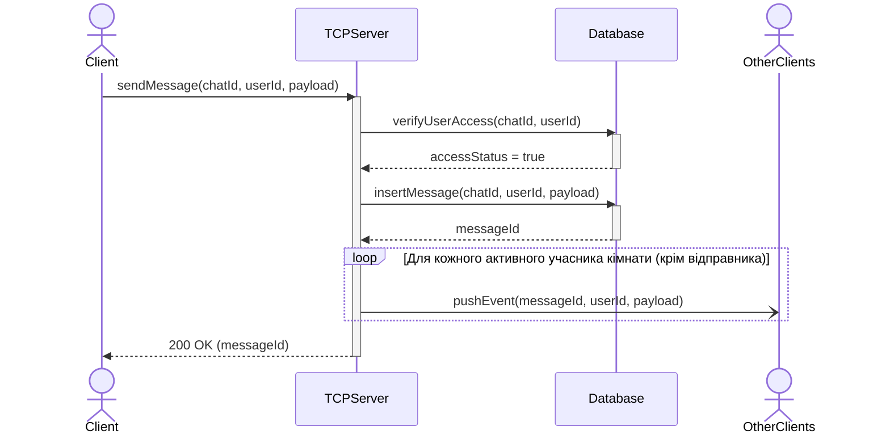
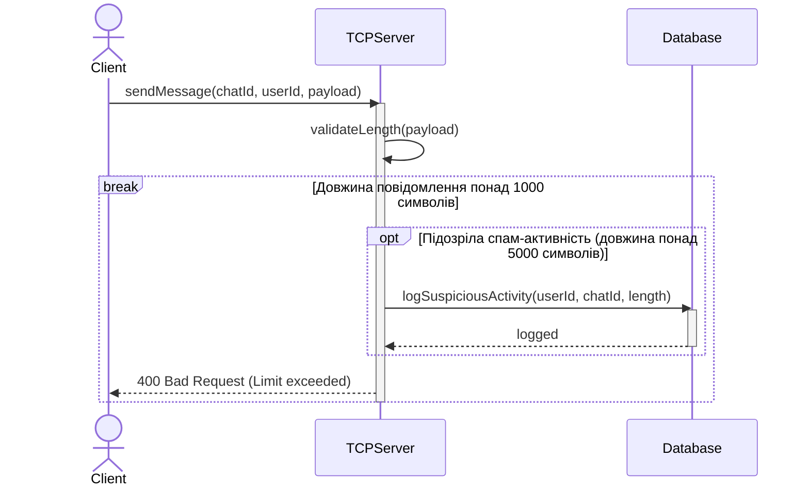
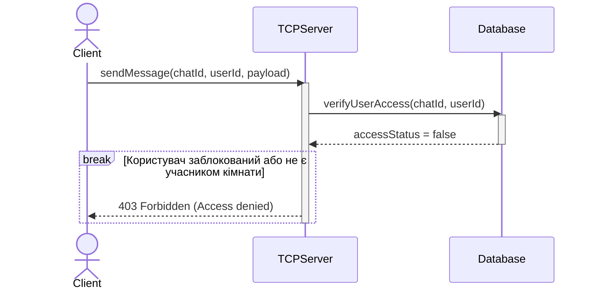

# Діаграми послідовності (UC: «Відправка повідомлення»)

## Сценарій 1: Успішна відправка повідомлення (Happy path)

## Сценарій 2: Перевищення ліміту довжини повідомлення (Alternate path)

## Сценарій 3: Відправка повідомлення заблокованим користувачем (Error path)

